# quantum-gravimeter

Rust crates for gravity, from the satellites that weigh Earth's water to the edges of physics.
Read the gravity fields measured by GRACE, GRACE-FO and GOCE and turn them into maps of water,
ice and earthquakes; simulate the quantum (cold-atom) sensors of future missions; chart
gravitational waves from nanohertz to terahertz; evaluate Earth's magnetic field and the
magnetohydrodynamics behind magnets, plasmas and space weather; compute the frontier proposals
for controlling gravity next to general relativity and the measurements; and model the plasmas
and fusion reactions that come up along the way. Every formula is tested against published numbers, and
the data tests are registered before the data decides them.



## The crates

| Crate | What it does |
|---|---|
| [`physica`](crates/physica) · [docs](https://docs.rs/physica) | All of them in one dependency, plus the cross-domain analogies: one spherical-harmonic engine for gravity and magnetism, the spin-2 factor, Schwinger and Unruh, the pinch and the filament |
| [`metrology`](crates/metrology) · [docs](https://docs.rs/metrology) | The physical constants every crate shares, defined once: SI, CODATA 2018, IERS and IAU values |
| [`geopotential`](crates/geopotential) · [docs](https://docs.rs/geopotential) | Earth's gravity field from spherical harmonics: read ICGEM `.gfc` models, then gravity, geoid and water height at a point or on a map |
| [`gravimetry`](crates/gravimetry) · [docs](https://docs.rs/gravimetry) | Gravity missions and quantum sensors (noise models, error predictions, a satellite-pair simulator), GRACE processing (technical notes, smoothing, stripe removal, water height, a Kalman smoother), earthquake gravity, buried-body forward models and the atmosphere's pressure waves |
| [`gravitational`](crates/gravitational) · [docs](https://docs.rs/gravitational) | Gravitational waves: strain conventions, noise curves, inspirals and binary pulsars, energy, memory, propagation and the graviton, stochastic backgrounds, high-frequency limits, gravity sensors as detectors, and lab gravity |
| [`gravitics`](crates/gravitics) · [docs](https://docs.rs/gravitics) | Frontier gravity computed three ways (each proposal's own model, general relativity, and the measurements): superconductors, high-frequency generators, propellantless thrust, pulsed-field "electrogravity", warp drives, the Schwinger limit, gravitoelectromagnetism, gravity's anomalies, MOND and short-range forces, and tabletop quantum gravity |
| [`magnetics`](crates/magnetics) · [docs](https://docs.rs/magnetics) | Earth's magnetic field from WMM2025 on the same engine as its gravity, magnetohydrodynamics (waves, shocks, stability, Hartmann flow, dynamos), magnet design and its stress limits, and space weather from the solar wind to the power grid |
| [`plasmoid`](crates/plasmoid) · [docs](https://docs.rs/plasmoid) | Fusion and self-organising plasma: Coulomb barriers and Gamow peaks, Bosch–Hale and p–¹¹B reaction rates, Lawson, tokamak limits, Z-pinches and the plasma focus, Taylor-relaxed plasmoids and reconnection, aneutronic power balance and direct energy conversion |
| [`lab`](lab) | The research workbench: regenerates every figure and reruns every analysis here (not published) |

[`geo5d`](https://crates.io/crates/geo5d) (heights, normal gravity, relativistic geodesy) uses
`geopotential` for its gravity.

[`web/`](web) holds 3D models of the physics, computed in the browser with the crates' equations.
The first one rebuilds the rig of US 12,417,870 (a ball between high-voltage coils, claimed to
move by a gravitational field), with its computed field lines and every force on the ball.

## Quick start

```bash
cargo add geopotential          # one domain
cargo add physica               # or all of them at once
```

Download a gravity model, for example `GOCO06s.gfc` from the
[ICGEM model table](https://icgem.gfz.de/tom_longtime), then:

```rust
use geopotential::read_gfc;

fn main() -> Result<(), Box<dyn std::error::Error>> {
    let model = read_gfc(&std::fs::read_to_string("GOCO06s.gfc")?)?.model.base;

    // Gravity 400 km above northern Italy (radius in metres, angles in radians).
    let (r, lat, lon) = (6_378_137.0 + 400e3, 45f64.to_radians(), 7f64.to_radians());
    let [north, east, up] = model.partials(r, lat, lon).acceleration_neu(r, lat);

    println!("gravity: {north:.2e} north, {east:.2e} east, {up:.4} up (m/s²)");
    Ok(())
}
```

Each crate's README has more examples, and every crate has runnable programs in its
`examples/` directory that reproduce a published number:

```bash
cargo run -p magnetics  --example compass_declination   # declination from WMM2025
cargo run -p gravitational --example binary_pulsar      # the Hulse–Taylor orbital decay
cargo run -p plasmoid   --example triple_products       # fusion shots against the Lawson limit
cargo run -p gravitics  --example electrogravity_claim  # a gravity claim against the classical force
cargo run -p physica    --example three_fields_one_engine
```

They are compiled and run by `cargo test`, so the numbers in them stay true.

## Gallery

| | |
|---|---|
|  **The geoid** from GOCO06s |  **An earthquake from space:** Kamchatka 2025 against the USGS fault model |
|  **El Niño drains the continents:** global land water and a registered forecast |  **What makes a month noisy:** solar activity and satellite modes |
|  **Quantum against classical sensors** ([Zingerle et al. 2024](https://doi.org/10.1029/2024EA003630), Fig. 1) |  **Simulated missions** against a real month |
|  **Each frontier proposal** against general relativity and experiment |  **What a warp bubble costs** against the quantum inequality |
|  **The Tonga pressure wave** as GRACE-FO would see it |  **Thrust per watt**: claims against light and ion wind |

## Research

Eight research reports, their notes and check scripts, the registered tests and their results,
the formula audits and the external research that has been reviewed into the crates are in
[`research/`](research/README.md), with the order of work in
[`research/roadmap.md`](research/roadmap.md). Each forecast is committed as a
git tag before the data that decides it exists, and results are reported whether they hit or
miss.

| Test | Question | Status |
|---|---|---|
| [W1](research/tests/W1/prereg.md) | How much water does land lose in an El Niño, and does it come back? | Registered 2026-10-24; scored from early 2027 |
| [E1](research/tests/E1/result.md) | Can monthly gravity see the 2025 Kamchatka earthquake, and is there more than the slip explains? | Detected. Matches the USGS fault model, with no excess |
| [Q0](research/tests/Q0/result.md) | What makes a monthly field noisy? | Solar activity and satellite modes |
| [Screen](figures/screen_indices.svg) | Which climate patterns move global land water? | Only El Niño, once 27 tests are accounted for |
| [Q2](research/tests/Q2/result.md) | Are the stated errors of the monthly fields right? | Too small, by about 2× above degree 10 |
| [M1](research/tests/M1/result.md) | Can a blind search of every month and place find earthquakes? | Sumatra and Tohoku, with no false alarms; smaller ones need a targeted test |
| [T1](research/tests/T1/result.md) | Does GRACE-FO's laser ranging feel the 2022 Tonga eruption's pressure wave? | Not detected: 1.75 ± 1.52 hPa on the first day (Z = 1.15, p = 0.12; 95% limit 4.3 hPa, against the expected 2.1–3.9), and nothing on the wave's second pass. Registered and frozen before the data was seen |

**Findings so far:**
- **El Niño drains the land.** Global land loses about 620 km³ of water per °C of El Niño
  (p < 0.001). La Niña's effect is smaller and not significant. The forecast for the 2026 El
  Niño is a loss of about 1,300 km³ by December, about 3.7 mm of sea level.
- **The Kamchatka earthquake is seen from orbit.** The Mw 8.8 earthquake left a
  −3.5 / +3.5 µGal dipole, larger than at any of 100 random places.
  - It has 0.91 ± 0.16 times the amplitude of the USGS fault model
    ([Okubo 1992](https://doi.org/10.1029/92JB00178) half-space), with correlation 0.59, so the
    slip explains it.
  - After-slip is not significant yet (p = 0.08).
- **The sun adds noise.** Solar activity raises the short-wavelength noise of a month by 30% per
  standard deviation of solar flux. At the 300 km scale used above, no factor matters, so solar
  maximum does not explain those results.
- **A blind search finds the two biggest earthquakes and nothing false.** Searching every month
  and place, with no catalogue, found Sumatra 2004 and Tohoku 2011 and no false alarms in 254
  months. No flood or drought made a step that sudden.
- **The stated errors are too small.** Above degree 10, the monthly fields scatter 2 to 2.5 times
  more than their stated errors. Scaled up, a Kalman smoother predicts withheld months with
  calibrated errors (rms 1.07), so it can fill the gaps in the record and map its uncertainty.

## Reproduce everything

You need Rust 1.85 or later. All the data is free.

**1. Download the data** (about 150 MB; T1 also needs GRACE-FO Level-1B and AOD1B from PO.DAAC, which need a free
Earthdata login, and the GOT4.10c tide grids from NASA GSFC):

```bash
mkdir -p data && cd data

# Every COST-G monthly field, 2002–2026, as one zip
curl -L -o costg.zip https://icgem.gfz.de/getseries/02_COST-G_/Grace-Grace-FO_RL02.1
unzip -q -j costg.zip -d costg
mkdir -p baseline && cp costg/GSM-2_200[4-9]*.gfc baseline/

# GRACE technical notes: C20 and C30 from laser ranging (TN-14), degree 1 (TN-13)
curl -LO https://archive.podaac.earthdata.nasa.gov/podaac-ops-cumulus-docs/gracefo/open/docs/TN-14_C30_C20_GSFC_SLR.txt
curl -LO https://archive.podaac.earthdata.nasa.gov/podaac-ops-cumulus-docs/gracefo/open/docs/TN-13_GEOC_CSR_RL0603.txt

# A static model
curl -L -o GOCO06s.gfc https://icgem.gfz.de/getmodel/gfc/32ec2884630a02670476f752d2a2bf1c395d8c8d6d768090ed95b4f04b0d5863/GOCO06s.gfc

# Climate indices (NOAA PSL), and solar and geomagnetic activity (GFZ Potsdam)
mkdir -p indices
for f in nina34.anom pdo amon.us nao ao aao qbo solar; do
  curl -L -o indices/$f.data https://psl.noaa.gov/data/correlation/$f.data
done
curl -L -o indices/dmi.had.long.data https://psl.noaa.gov/gcos_wgsp/Timeseries/Data/dmi.had.long.data
curl -L -o indices/Kp_ap_Ap_SN_F107_since_1932.txt https://kp.gfz-potsdam.de/app/files/Kp_ap_Ap_SN_F107_since_1932.txt

# Every earthquake of magnitude 8 or more since 2002 (USGS)
curl -L -o usgs_m8_2002_2026.csv "https://earthquake.usgs.gov/fdsnws/event/1/query?format=csv&starttime=2002-04-01&endtime=2026-08-01&minmagnitude=8.0&orderby=time-asc"

# The USGS fault model of the 2025 Kamchatka earthquake
mkdir -p usgs_us6000qw60
for f in coulomb.inp surface_deformation.disp; do
  curl -L -o usgs_us6000qw60/$f https://earthquake.usgs.gov/product/finite-fault/us6000qw60_1/us/1763589364802/$f
done
cd ..
```

For T1, also download GRACE-FO Level-1B, AOD1B and the GOT4.10c ocean tides. The PO.DAAC
files need a free [Earthdata login](https://urs.earthdata.nasa.gov/) in `~/.netrc`:

```bash
cd data
P=https://archive.podaac.earthdata.nasa.gov/podaac-ops-cumulus-protected
mkdir -p gracefo_l1b/aod1b tides
for d in 13 14 15 16; do
  for k in LRI noLRI; do
    curl -n -L -o gracefo_l1b/gracefo_1B_2022-01-${d}_RL04.ascii.$k.tgz $P/GRACEFO_L1B_ASCII_GRAV_JPL_RL04/gracefo_1B_2022-01-${d}_RL04.ascii.$k.tgz
    mkdir -p gracefo_l1b/2022-01-$d && tar xzf gracefo_l1b/gracefo_1B_2022-01-${d}_RL04.ascii.$k.tgz -C gracefo_l1b/2022-01-$d
  done
done
curl -n -L -o gracefo_l1b/AOD1B_2022-01_06.tgz $P/GRACE_AOD1B_GRAV_GFZ_RL06/AOD1B_2022-01_06.tgz
tar xzf gracefo_l1b/AOD1B_2022-01_06.tgz -C gracefo_l1b/aod1b
curl -L -o tides/got4.10c.tar.gz https://earth.gsfc.nasa.gov/sites/default/files/2023-12/got4.10c.tar.gz
tar xzf tides/got4.10c.tar.gz -C tides
cd ..
```

**2. Make the figures.** Each command writes an SVG and, for most, a CSV of the plotted values.
Set three shortcuts first:

```bash
MONTH=data/costg/GSM-2_2026182-2026212_GRFO_COSTG_BF01_0201.gfc
TN14=data/TN-14_C30_C20_GSFC_SLR.txt
TN13=data/TN-13_GEOC_CSR_RL0603.txt
```

| Command (`cargo run --release -p lab -- …`) | Figure |
|---|---|
| `geoid data/GOCO06s.gfc figures` | [The geoid](figures/geoid_goco06s.svg) |
| `water-map $MONTH data/baseline $TN14 $TN13 figures` | [Water in July 2026](figures/water_2026-07.svg) |
| `triangle $MONTH figures` | [Error of each coefficient](figures/error_triangle_2026-07.svg) |
| `noise figures` | [Instrument noise](figures/noise_spectra.svg) |
| `gradiometry data/GOCO06s.gfc figures` | [Gradiometer missions](figures/gradiometry_errors.svg) |
| `sst figures $MONTH` | [Simulated missions](figures/sst_closed_loop.svg) (about 5 minutes and 1 GB per mission) |
| `w1 data/costg data/baseline $TN14 $TN13 data/indices/nina34.anom.data figures` | [El Niño and land water](figures/w1_land_storage.svg) |
| `screen figures/w1_land_storage.csv data/indices figures` | [Climate-index screen](figures/screen_indices.svg) |
| `q0 data/costg data/baseline $TN14 $TN13 data/indices/Kp_ap_Ap_SN_F107_since_1932.txt figures` | [Noise](figures/q0_noise.svg) |
| `e1 data/costg data/baseline $TN14 $TN13 data/usgs_us6000qw60 figures/q0_noise.csv figures` | [Kamchatka earthquake](figures/e1_kamchatka.svg) |
| `kalman data/costg data/baseline $TN14 $TN13 figures` | [Are COST-G's errors right?](figures/kalman.svg) |
| `m1 data/costg data/baseline $TN14 $TN13 figures/kalman_degrees.csv data/usgs_m8_2002_2026.csv figures` | [Blind search for sudden mass changes](figures/m1_detector.svg) |
| `tonga figures` | [The Tonga Lamb wave as GRACE-FO would see it](figures/tonga_lamb_wave.svg) |
| `claims figures` | [Each proposal against general relativity](figures/claims_gap.svg), [warp energy](figures/warp_energy.svg), [thrust per watt](figures/thrust_per_watt.svg) |
| `t1-test data/gracefo_l1b data/gracefo_l1b/aod1b data/GOCO06s.gfc data/costg/GSM-2_2022001-2022031_GRFO_COSTG_BF01_0201.gfc data/tides/GOT4.10c/grids_oceantide figures --unblind 2022-01-13 2022-01-14 2022-01-15 2022-01-16` | [The T1 test](research/tests/T1/result.md) (GRACE-FO Level-1B and AOD1B from PO.DAAC, GOT4.10c from NASA GSFC) |

## How it is checked

```bash
cargo test --workspace
```

The tests compare against:
- closed-form results;
- published tables, such as Okada's (1985) check values and the Wahr et al. (1998) Love numbers;
- an independent implementation (geo5d, to about 1e-15);
- the published figures of Zingerle et al. (2024), CARIOQA and GRICE;
- simulations that recover a known field;
- the numbers in the research notes' check scripts, for every physics formula;
- NOAA's official World Magnetic Model test values, all 100 rows.

Every example in the crate READMEs is compiled and run as a test.

**Limits:**
- **Glacial isostatic adjustment is not removed**, so Hudson Bay and Scandinavia show crustal
  rebound as water gain.
- **No leakage correction yet.**
- **The simulator has no time-variable gravity**, so it cannot show temporal aliasing.

## Data and sources

**Data:**
- **COST-G monthly fields:** [doi:10.5880/COST-G.ICGEM_02_L2](https://doi.org/10.5880/COST-G.ICGEM_02_L2), CC BY 4.0.
- **GOCO06s:** [doi:10.5880/ICGEM.2019.002](https://doi.org/10.5880/ICGEM.2019.002), CC BY 4.0.
- **GRACE technical notes:** NASA, via
  [PO.DAAC](https://archive.podaac.earthdata.nasa.gov/podaac-ops-cumulus-docs/gracefo/open/docs/).
- **Climate indices:** [NOAA PSL](https://psl.noaa.gov/data/climateindices/list/).
- **Solar and geomagnetic activity:** GFZ Potsdam,
  [doi:10.5880/Kp.0001](https://doi.org/10.5880/Kp.0001), CC BY 4.0.
- **GRACE-FO Level-1B (RL04) and AOD1B (RL06):** NASA JPL and GFZ, via
  [PO.DAAC](https://podaac.jpl.nasa.gov/).
- **GOT4.10c ocean tides:** R. Ray, [NASA GSFC](https://earth.gsfc.nasa.gov/geo/data/ocean-tide-models).
- **Kamchatka fault model:** [USGS](https://earthquake.usgs.gov/earthquakes/eventpage/us6000qw60/finite-fault).
- **Coastlines and land:** [Natural Earth](https://www.naturalearthdata.com/).

**Key papers:**
- Wahr et al. (1998), [water from gravity](https://doi.org/10.1029/98JB02844).
- Swenson & Wahr (2006), [stripe removal](https://doi.org/10.1029/2005GL025285).
- Landerer & Swenson (2012), [GRACE Tellus maps](https://doi.org/10.1029/2011WR011453).
- Holmes & Featherstone (2002), [high-degree Legendre functions](https://doi.org/10.1007/s00190-002-0216-2).
- Okada (1985) [uplift](https://doi.org/10.1785/BSSA0750041135) and Okubo (1992)
  [gravity](https://doi.org/10.1029/92JB00178) from faults.
- Zingerle et al. (2024), [quantum accelerometers for gravimetry](https://doi.org/10.1029/2024EA003630).

The [research reports](research/README.md) cite the sources of every formula.
